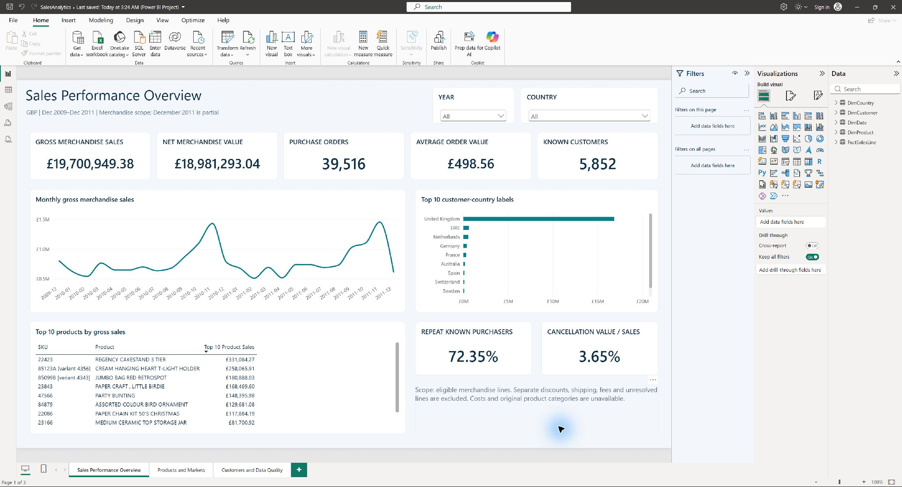
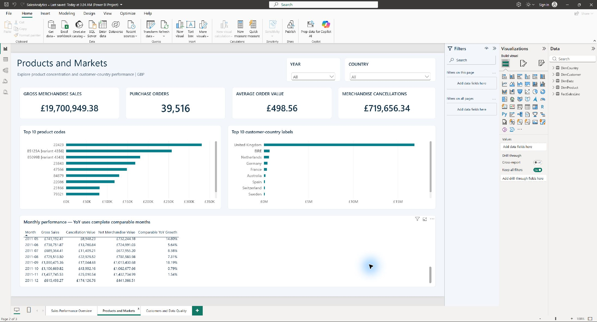
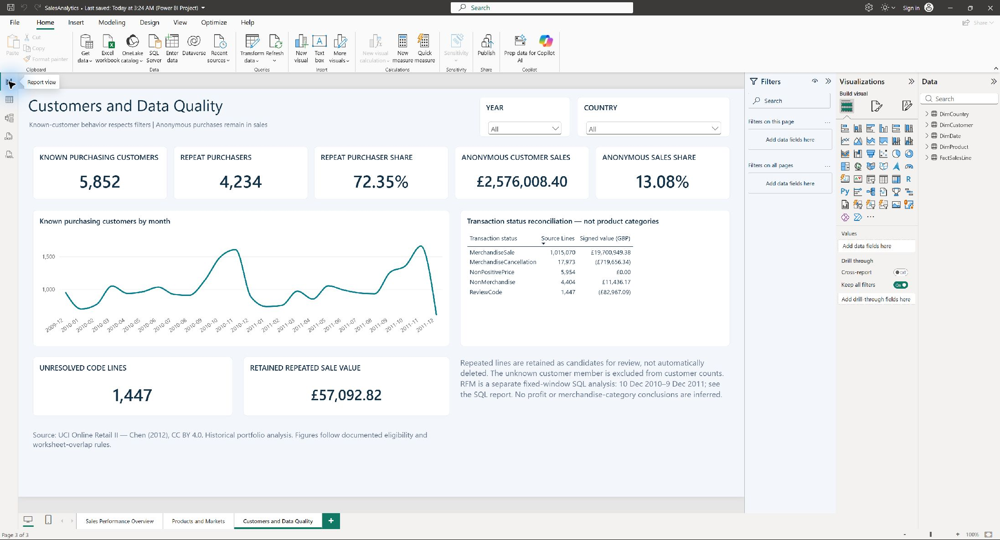
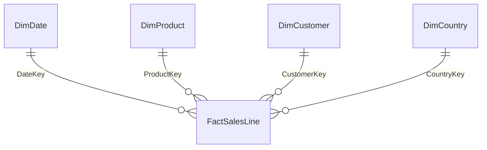

<div align="center">

# Sales Performance Analytics

### From retail transactions to actionable sales and customer insights

**SQL Server · T-SQL · Power BI · DAX · Power Query · Python**

[Dashboard](#dashboard) · [Key findings](#key-findings) · [Data model](#data-model) · [Reproduce this project](#reproduce-this-project)

</div>

---

## Overview

An end-to-end retail analytics project that transforms **1.07 million invoice lines** into a validated SQL Server star schema and a three-page Power BI report. The analysis explores sales performance, product and market contribution, customer purchasing behavior, and the effect of cancellations and data quality on reported metrics.

**Business objective:** provide a consistent view of sales performance and identify evidence-based opportunities for demand planning, customer retention, and better data capture.

## Performance at a glance

**Period: 1 December 2009–9 December 2011 · Currency: GBP**

| Gross merchandise sales | Net merchandise transaction value | Purchase orders | Average order value |
| :---: | :---: | :---: | :---: |
| **£19.70M** | **£18.98M** | **39,516** | **£498.56** |

Gross sales are £19,700,949.38; merchandise cancellation value is £719,656.34. Net merchandise transaction value subtracts these cancellations and excludes separate shipping, fees, discounts, vouchers, and unresolved lines. It is not audited accounting net revenue.

## Dashboard

### 01 · Sales Performance Overview

Sales KPIs, monthly trends, top products, and market comparisons, with year and country slicers.



<details>
<summary><strong>02 · Products and Markets</strong></summary>

Product rankings, country contribution, and monthly sales comparisons.



</details>

<details>
<summary><strong>03 · Customers and Data Quality</strong></summary>

Known and repeat purchasers, anonymous sales, transaction status, and repeated-line sensitivity.



</details>

## Key findings

| Finding | Business implication |
| --- | --- |
| **2.89% growth** in January–November 2011 against the same months in 2010 | Use comparable complete periods when evaluating growth. |
| **November was the largest complete sales month** in both 2010 and 2011 | Review stock and operational capacity ahead of the historical peak. |
| **85.56% of gross sales** came from the United Kingdom | Prioritize service reliability in the largest market; assess costs before expanding elsewhere. |
| **16.42% of known purchasing customers** placed 10+ orders and contributed **66.59% of known-customer gross sales** | Focus account-service and retention analysis on frequent purchasers. |
| **13.08% of gross sales** had no customer ID | Improve customer identification to strengthen customer-level analysis. |

The separate SQL RFM analysis segments **4,261 known customers** in a fixed one-year purchase window. Champions represented **62.60%** of gross purchases within that window. Segment definitions are descriptive analyst rules, not validated churn predictions.

Read the [full business insights report](reports/business_insights.md) for seven findings, calculations, denominators, limitations, and proposed actions. Recommendations have not been implemented or evaluated for business impact.

## Data model



**Fact grain:** one canonical source invoice line. Four dimensions filter **1,044,848 fact rows** through one-to-many relationships.

The original worksheets overlap in time. A documented date partition excludes **22,523 overlapping-extract rows** from the analytical timeline while preserving all source rows in staging. Remaining repeated-line candidates are flagged and retained. Missing customer IDs remain in sales totals but are excluded from known-customer counts and RFM.

See the [database design](docs/database_model.md), [data dictionary](docs/data_dictionary.md), and [metric definitions](docs/metric_definitions.md).

## Technical highlights

- **SQL:** joins, CTEs, conditional aggregation, subqueries, and window functions for sales trends, product rankings, country comparisons, and tie-aware RFM segmentation.
- **Data quality:** source-row provenance, primary and foreign keys, decimal arithmetic, exception classification, and source-to-model reconciliation.
- **Power BI:** three report pages, four dimension relationships, 18 DAX measures, and interactive year/country filters.
- **Validation:** 15 saved SQL-result checks and 16 executed DAX checks passed. Year and country filter behavior was reconciled against SQL.
- **Product identity:** case-sensitive source SKU variants receive disambiguated display labels where required by Power BI text comparisons.

[SQL analysis](sql/20_sales_analysis.sql) · [SQL results](reports/phase_3_sql_analysis.md) · [Power BI validation](reports/phase_4_verification.md)

## Repository structure

```text
sales-performance-analytics/
├── sql/                    Database, transformation, validation, and analysis scripts
├── powerbi/                Native PBIP report, semantic model, DAX, and theme
├── dashboard/screenshots/  Three actual report screenshots
├── reports/                Profiling, executed results, verification, and insights
├── docs/                   Setup guides, data dictionary, and metric definitions
├── scripts/                Profiling, CSV export, and report-generation tools
└── data/                   Provenance notes; raw and processed data excluded from Git
```

## Reproduce this project

1. **Download the source:** follow [dataset setup](docs/01_dataset_setup.md). Python profiling/export tools require `pandas` and `openpyxl`; review their help and documented paths.
2. **Build the database:** follow [SQL Server setup](docs/02_database_setup.md) and run SQL scripts 00–13 in numeric order with your own instance and CSV path. First-load scripts stop on populated staging or facts; use read-only validation for an existing build.
3. **Run the analysis:** execute [20_sales_analysis.sql](sql/20_sales_analysis.sql). The [SQL guide](docs/06_sql_analysis_guide.md) explains the queries and outputs.
4. **Open the dashboard:** open `powerbi/SalesAnalytics.pbip` with its Report and SemanticModel folders alongside it. Set your SQL instance, authenticate, and refresh using the [Power BI guide](docs/07_powerbi_dashboard_guide.md). The local `.pbi` cache is excluded from Git.
5. **Validate:** run the provided SQL and DAX checks. `python scripts/build_business_report.py` regenerates findings from saved SQL JSON; it does not refresh the database or report.

The development engine was SQL Server 2025. Scripts target SQL Server 2022 compatibility but have not been separately executed on a 2022 engine. The dashboard was verified in Power BI Desktop.

## Dataset and scope

**[UCI Online Retail II](https://archive.ics.uci.edu/dataset/502/online+retail+ii)** contains historical transactions from a UK online retailer. The original workbook has **1,067,371 rows** across two worksheets. One row is an invoice line, not an entire order.

- Costs and source merchandise categories are absent; profit, margin, and category analysis are unavailable.
- Country is a source customer-country label; subnational regions and verified delivery destinations are unavailable.
- December 2011 is partial. Growth comparisons use matched complete periods.
- Merchandise eligibility includes a documented provisional code-pattern rule. Review populations remain visible and excluded from merchandise KPIs.
- Cancellation records do not establish physical returns. Historical findings do not describe current market conditions.

**Attribution:** Chen, D. (2012). *Online Retail II* [Dataset]. UCI Machine Learning Repository. [DOI: 10.24432/C5CG6D](https://doi.org/10.24432/C5CG6D). Dataset licensed under [CC BY 4.0](https://creativecommons.org/licenses/by/4.0/). Transformations are documented in the database design and analysis reports. No project-code license is currently asserted.
