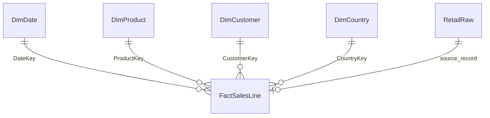

# Database model and transformation rules

## Grain and relationships

`dbo.FactSalesLine` stores one canonical source line, including non-merchandise and review populations. Its unique `(SourceSheet, SourceRowNumber)` constraint prevents duplicate source loads. Five foreign keys enforce relationships to the four dimensions and original staging record.

In Power BI, use only the four dimension-to-fact relationships, one-to-many with single-direction filtering. Staging is an audit source, not a report relationship. SourceSheet and SourceRowNumber jointly identify provenance in SQL; do not try to create two independent Power BI relationships to staging.

## Table dictionary

| Table | Key | Important fields and rules |
| --- | --- | --- |
| stg.RetailRaw | SourceSheet + SourceRowNumber | All source values as text; two original worksheets remain intact |
| dbo.StockCodeClassification | StockCode | Analyst-created purpose labels; not source merchandise categories |
| dbo.DimDate | DateKey (YYYYMMDD) | CalendarDate unique; full calendar years; numeric year/month, YearMonth, MonthStart, complete-source-month flag |
| dbo.DimProduct | ProductKey identity | Case-sensitive unique StockCode with trailing spaces removed; latest nonblank description selected deterministically |
| dbo.DimCustomer | CustomerKey identity | Unique known CustomerID; one NULL-ID unknown member, IsUnknown=1 |
| dbo.DimCountry | CountryKey identity | Unique source country label; no invented regions |
| dbo.FactSalesLine | SalesLineKey identity | Dimension foreign keys, source key, invoice/timestamp, quantity, price, signed value, purpose/status, repeated-line flag |

The unknown customer dimension member is only a relationship placeholder for anonymous sales. Exclude IsUnknown=1 from customer counts and RFM. Never interpret the member as one real repeat purchaser.

Product display descriptions come from the latest nonblank description by transaction timestamp, worksheet, and source row as a deterministic tie-breaker. Raw line descriptions remain available in staging and the canonical view. Historical descriptions are not overwritten in staging. The model uses a single current display label per SKU, not a slowly changing product dimension.

SQL Server string comparisons can ignore trailing spaces. Product dimension keys deliberately use RTRIM; source text stays intact. The binary collation preserves case distinctions. These details can cause duplicate diagnostics to differ from byte-identical source matching and should be disclosed when comparing Python and SQL checks.

## Transformation chain

1. Original workbook exported without business cleaning to UTF-8 CSV, preserving sheet and Excel row.
2. CSV imported transactionally into staging and reconciled to source row/quality controls.
3. Canonical view assigns dates before 1 December 2010 to the first worksheet and later dates to the second.
4. Classification view applies explicit lookup mappings first; five-digit prefixes otherwise produce MerchandiseCandidate; remaining codes stay Review.
5. Eligibility view assigns one transaction status per canonical line. All lines survive.
6. Transactional star-schema load materializes dimensions and facts, checks row/value totals, and creates query indexes.

Line value uses decimal arithmetic, not float. A CHECK constraint enforces quantity × unit price. No positive-only constraint is applied to quantities or prices because exceptions must remain visible.

IsRepeatedLine marks all but the first row of each matching canonical value group. It is a diagnostic flag, not evidence of an error. Repeated lines are retained. Use the flag for sensitivity analysis rather than silently filtering it out.

DimDate covers full calendar years for time intelligence. IsCompleteSourceMonth describes whether month boundaries lie within observed source coverage, not proof that the source has every expected business transaction. Months outside observed coverage must not be displayed as known zero-sales periods.

## Execution and reruns

- Scripts 00–04 set up and validate staging. Never reload nonempty staging.
- Scripts 05–10 define views and maintain explicit classification mappings.
- Script 11 performs the first star load inside a transaction. It stops if facts already exist; it never drops or truncates data. Failed builds roll back.
- Script 12 is a repeatable read-only validation suite.
- If mappings or eligibility rules change later, design an explicit refresh process and reconcile the resulting snapshot. Rerunning 11 is not an incremental update feature.

This project intentionally does not add an order header yet. Some invoices have multiple timestamps. The fact retains original timestamps, and purchase orders will be counted as distinct eligible purchase invoice identifiers with the reporting-period convention stated in Phase 3.
